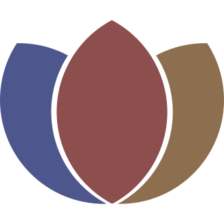

<p align="center">
  
</p>

<h1 align="center">LotusTab</h1>

A desktop database client for **PostgreSQL**, **MySQL**, and **ClickHouse**. Open connections, browse tables, run SQL, and keep as many tabs as you need — without parking passwords in config files.

## Download

Install from the latest GitHub Release (preferred over building from source):

**[Download LotusTab](https://github.com/JhnBer/lotustab/releases/latest)**

| Platform | What to grab |
| --- | --- |
| macOS (Intel + Apple Silicon) | `lotustab-darwin-universal-*.zip` (or `.dmg`) |
| Windows (x64) | `lotustab-windows-amd64-*.exe` |
| Linux (x64) | `lotustab-linux-amd64-*.tar.gz` |

Checksums ship as `SHA256SUMS` on the same release. The in-app updater uses this channel; restart is always manual.

## What you get

- **Engines:** PostgreSQL, MySQL, and ClickHouse adapters
- **Keychain secrets:** passwords live in the OS keychain, not in profile JSON or logs
- **SSH tunnels:** connect through SSH, including an optional jump host
- **Unlimited tabs:** query tabs and table browse tabs side by side
- **One results grid:** table browse and SQL results share the same grid; large values open beside it

## License

LotusTab is licensed under the [GNU General Public License v3.0](LICENSE).

Contributions are accepted under MIT via the [CLA](CLA.md). See [CONTRIBUTING.md](CONTRIBUTING.md).

## Build from source

For contributors and packaging. Everyday installs should use [Releases](https://github.com/JhnBer/lotustab/releases/latest).

Requires Go 1.25+ (toolchain auto-downloads) and [Wails v3](https://wails.io/):

```bash
go install github.com/wailsapp/wails/v3/cmd/wails3@latest
wails3 dev
```

```bash
wails3 build                 # binary → bin/
wails3 task package          # host OS package (.app / installer / Linux packages)
```

Release version comes from the latest git tag (`v0.1.0` → `0.1.0`) via `APP_VERSION`. Cross-compile and sign with the platform tasks under `build/` (`darwin:*`, `windows:*`, `linux:*`). Architecture notes live in `AGENTS.md` and the Taskfiles.

```bash
# example: stamp a release build from a tag
git tag -a v0.1.0 -m "v0.1.0"
wails3 task darwin:package:universal APP_VERSION=0.1.0
```
